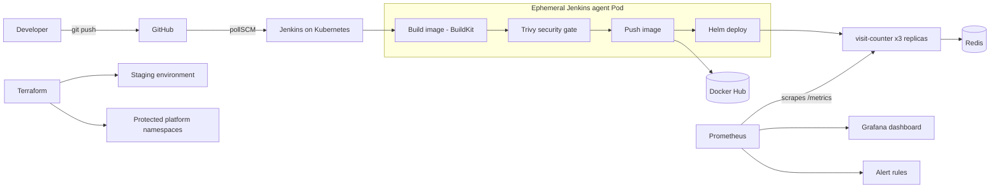

# Kubernetes CI/CD & Observability Platform

An end-to-end DevOps project that takes a containerized web application from **`git push` to a monitored, zero-downtime deployment on Kubernetes**. It includes CI/CD on Kubernetes, a container security gate, Helm packaging, Prometheus/Grafana observability, and Terraform-managed environments.

Every push to `main` is built, scanned for vulnerabilities, published, and deployed automatically. Vulnerable images are blocked **before** they reach the registry.

> Runs on a local Kubernetes cluster (Minikube, Docker driver). All tools are installed with pinned versions and managed as code in this repository.

---

## Architecture



## Tech stack

| Area | Tools |
|---|---|
| Application | Python 3.12 (Flask, gunicorn), Redis |
| Containers | Docker, BuildKit (daemonless builds inside Kubernetes) |
| Orchestration | Kubernetes (Minikube), Helm 4 |
| CI/CD | Jenkins (Helm chart, Kubernetes agents, Declarative Pipeline) |
| Security | Trivy (image scanning gate), Kubernetes RBAC, non-root containers |
| Observability | Prometheus, Grafana, kube-prometheus-stack (Prometheus Operator) |
| Infrastructure as Code | Terraform (Kubernetes, Helm, and Random providers) |

## Repository structure

```
.
├── app/                      # Flask app, Dockerfile, .dockerignore
├── charts/visit-counter/     # Helm chart (Deployment, Service, ServiceMonitor)
│   ├── values.yaml           #   defaults
│   ├── values-dev.yaml       #   dev / staging overrides
│   └── values-prod.yaml      #   production overrides
├── kubernetes/               # Plain manifests: Redis, ConfigMaps, Secret templates, Nginx web-app
├── platform/
│   ├── jenkins/              # Jenkins Helm values + least-privilege deployer RBAC
│   └── monitoring/           # kube-prometheus-stack values, Grafana dashboard, alert rules
├── terraform/
│   ├── platform/             # Imported long-lived namespaces (prevent_destroy)
│   └── staging/              # Disposable staging environment
├── experiments/              # Learning exercises (OOMKill, PVC Job)
└── Jenkinsfile               # CI/CD pipeline as code
```

---

## CI/CD pipeline

Defined in [`Jenkinsfile`](Jenkinsfile). Every build runs in a **fresh agent Pod** that is deleted afterwards. The Jenkins controller has zero executors.

| Stage | What it does |
|---|---|
| **Build Image** | BuildKit builds the image into a local tarball, with no registry push and no credentials needed |
| **Security Scan (Trivy)** | Scans the tarball and **fails the build** on fixable HIGH/CRITICAL vulnerabilities |
| **Push Image** | Runs only if the scan passed. Pushes `sathvik627/visit-counter:1.1.<build>` to Docker Hub |
| **Deploy with Helm** | `helm upgrade --install --wait` with production values and the new image tag |

Pipeline design decisions:

- **Scan before push.** A vulnerable image never reaches the registry. The scanned and pushed images were verified to have the **same manifest digest**.
- **Least privilege.** Agents run as a dedicated ServiceAccount that can manage only the app's resource types, only in the app's namespace (verified with `kubectl auth can-i`).
- **Credentials.** The Docker Hub access token lives in the Jenkins credential store. It is loaded only in the push stage and kept out of logs, including derived values.
- **`disableConcurrentBuilds()`.** Serializes deployments after two overlapping builds caused a Helm "another operation is in progress" failure.
- **Pinned tooling.** BuildKit, Helm, and Trivy images are pinned. Trivy is pinned **by digest**, following the 2026 Trivy supply-chain compromise.

## Application

A small Flask API that counts visits in Redis.

| Endpoint | Purpose |
|---|---|
| `/` | Increments and returns the visit count, Pod name, and app version |
| `/healthz` | **Liveness:** the process is alive (deliberately does *not* check Redis) |
| `/readyz` | **Readiness:** Redis is reachable, so the Pod can receive traffic |
| `/metrics` | Prometheus metrics |

- Image: Alpine-based, **non-root (UID 10001)**, about **57% smaller** than the first version, with Alpine security patches applied at build time.
- The app version is baked into the image at build time (`--build-arg APP_VERSION`), so the image is the single source of truth.
- Runs with 3 replicas, resource requests and limits, `runAsNonRoot`, `allowPrivilegeEscalation: false`, and all Linux capabilities dropped.

## Reliability

- **Zero-downtime rolling updates:** `maxSurge: 1`, `maxUnavailable: 0`, plus readiness probes.
- **`preStop` hook:** load testing showed **1 of 90 requests dropped** during a rollout, caused by the race between endpoint removal and SIGTERM. A 5-second `preStop` sleep fixed it: **90/90 requests succeeded** in the repeat test.
- **Helm rollbacks** restore the complete release with no configuration drift, compared and documented against `kubectl rollout undo`.

## Observability

- **Application metrics** (golden signals): `visit_counter_http_requests_total` (by method, route, and status) and `visit_counter_http_request_duration_seconds` (histogram, p50/p95 latency).
- **ServiceMonitor** shipped in the Helm chart, so Prometheus discovers the app automatically.
- **Grafana dashboard as code:** a ConfigMap loaded by the Grafana sidecar, showing request rate (total and per Pod), error rate, latency, and memory.
- **Alert rules** (`PrometheusRule`):
  - `VisitCounterNoReadyPods` (critical): no Pods available for 1 minute
  - `VisitCounterHighErrorRate` (warning): 5xx above 5% for 2 minutes
  - `VisitCounterHighLatency` (warning): p95 above 500 ms for 5 minutes
- **Alerts tested by failure injection:** stopping Redis moved `VisitCounterNoReadyPods` through `inactive → pending → firing`.

## Infrastructure as Code (Terraform)

Two separate Terraform projects with **separate state**, to limit the blast radius of a bad change:

**`terraform/platform/`** manages the long-lived namespaces (`kubernetes-learning`, `jenkins`, `monitoring`).
- Adopted from existing infrastructure with `import` blocks and `-generate-config-out`, cleaned up until the plan showed **zero changes**.
- Protected with `lifecycle { prevent_destroy = true }`.

**`terraform/staging/`** builds a complete, disposable copy of the app:
- Namespace with a **ResourceQuota** and **LimitRange**
- A **generated Redis password** (`random_password`) stored in a Kubernetes Secret
- Redis Deployment and Service, plus the app's Helm release with `values-dev.yaml`
- Destroyed and recreated end to end; the rebuilt environment matched exactly, down to the Pod template hash

Workflow: `fmt` → `validate` → `plan -out` → `apply <planfile>`, with **drift detection** using `plan -detailed-exitcode`.

---

## Problems solved

| Problem | Root cause | Fix |
|---|---|---|
| Dropped request during rolling update | Endpoint removal and SIGTERM race | `preStop` sleep hook |
| Helm upgrades failing after migration | Server-Side Apply field-ownership conflict with the old `kubectl apply` manager | Removed the obsolete `managedFields` entry with a guarded JSON Patch |
| Grafana dashboards showing "No data" | cAdvisor under cri-dockerd missing `container`/`image` labels | Pod-level PromQL queries |
| App metric labels renamed to `exported_endpoint` | Collision with a Prometheus target label | Renamed the label to `route` |
| p95 latency returned NaN | `rate()` can't see the first increase of a new series | Steady load generation, and an understanding of counter semantics |
| Stale env var after a rollback | `kubectl rollout undo` drift, invisible to `kubectl diff` | Removed it, then switched to Helm rollbacks |
| Two pipelines deploying at once | Concurrent builds | `disableConcurrentBuilds()` |
| 16 HIGH CVEs in the image | Base image lagging behind Alpine patches | `apk upgrade` at build time, enforced by the Trivy gate |

## Supply-chain practices

- Every tool, chart, provider, and image is **pinned to an exact version**. Trivy is also pinned by digest.
- **Minimum release age of about 14 days** before adopting any new version, checked through the GitHub Releases API.
- Terraform provider checksums are locked in `.terraform.lock.hcl`.
- Secrets are never committed. `.gitignore` excludes Secret manifests, Terraform state, and saved plans, and `*.example` templates document the expected structure.

---

## Running it locally

**Prerequisites:** Minikube (Docker driver, about 8 GB RAM), kubectl, Helm 4, Terraform ~> 1.17, and a Docker Hub account.

```bash
# 1. Cluster
minikube start --driver=docker --cpus=2 --memory=8192

# 2. App dependencies
kubectl create namespace kubernetes-learning
#    Secrets: copy the template, replace the placeholder value, then apply.
#    The real file is git-ignored, so the value never reaches the repository.
cp kubernetes/visit-counter-secret.yaml.example kubernetes/visit-counter-secret.yaml
kubectl apply -f kubernetes/visit-counter-secret.yaml
kubectl apply -f kubernetes/redis.yaml -f kubernetes/configmap.yaml

# 3. Monitoring
helm repo add prometheus-community https://prometheus-community.github.io/helm-charts
helm install monitoring prometheus-community/kube-prometheus-stack --version 92.17.0 \
  -n monitoring --create-namespace -f platform/monitoring/values.yaml
kubectl apply -f platform/monitoring/visit-counter-dashboard.yaml \
              -f platform/monitoring/visit-counter-alerts.yaml

# 4. The app
helm upgrade --install visit-counter charts/visit-counter -n kubernetes-learning \
  -f charts/visit-counter/values-prod.yaml --wait

# 5. Jenkins (then add Docker Hub credentials with ID "dockerhub-creds"
#    and create a "Pipeline script from SCM" job pointing to this repo)
helm repo add jenkins https://charts.jenkins.io
helm install jenkins jenkins/jenkins --version 5.13.1 -n jenkins --create-namespace \
  -f platform/jenkins/values.yaml
kubectl apply -f platform/jenkins/rbac.yaml

# 6. Staging environment with Terraform
terraform -chdir=terraform/staging init
terraform -chdir=terraform/staging plan -out=staging.tfplan
terraform -chdir=terraform/staging apply staging.tfplan
```

Access the services with port-forwarding:

```bash
kubectl port-forward svc/visit-counter 8081:80 -n kubernetes-learning      # app        → http://127.0.0.1:8081
kubectl port-forward svc/jenkins 8080:8080 -n jenkins                      # Jenkins    → http://127.0.0.1:8080
kubectl port-forward svc/monitoring-grafana 3000:80 -n monitoring          # Grafana    → http://127.0.0.1:3000
```

## Known limitations and next steps

- **Redis has no persistent storage:** visits reset if Redis restarts (shown during the alert test). Next step: a StatefulSet with a PVC.
- **Jenkins polls GitHub** because the local cluster isn't reachable from the internet. With a public endpoint, this would use webhooks.
- **Terraform state is local.** In a team setup it would live in an encrypted remote backend with locking.
- **No build cache between pipeline runs:** each agent Pod starts cold. Next step: BuildKit registry cache export/import.
- Planned additions: GitOps with Argo CD, Ingress, HorizontalPodAutoscaler, NetworkPolicies, and SLOs with burn-rate alerts.

---

## Author

**Sathvik Kumar**, DevOps Engineer
[LinkedIn](https://www.linkedin.com/in/sathvik-kumar007/) · [GitHub](https://github.com/Sathvik-911)